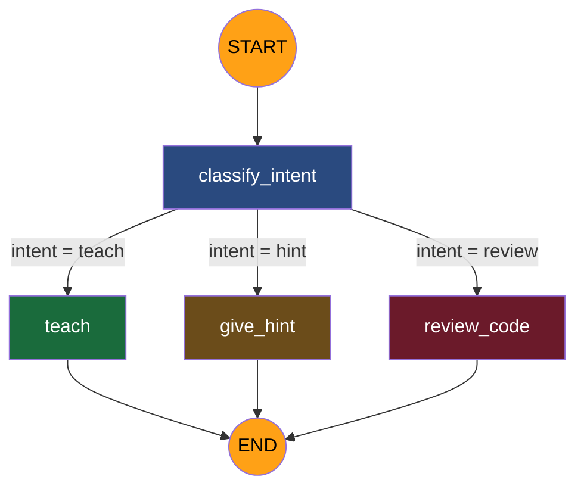

# 🤖 AI LeetCode Coach

An AI-powered Chrome Extension that acts as a personal coding tutor on LeetCode. Instead of giving you answers, it **teaches you how to think** — using the Socratic method, progressive hints, and code reviews.

Built with **FastAPI + LangGraph + Google Gemini + React**.

---

## How It Works

```
LeetCode Page                     Side Panel (Extension)              Backend
┌────────────────────┐     ┌──────────────────────────┐     ┌──────────────────┐
│                    │     │  🤖 AI LeetCode Coach    │     │                  │
│  Two Sum           │◄──►│  Problem: Two Sum        │────►│  FastAPI Server   │
│  Given an array... │ extract │                      │     │       │          │
│                    │ slug │  💬 "I'm stuck"         │     │  LangGraph AI    │
│  [Code Editor]     │ lang │  🤖 "What data structure│◄────│  (Gemini LLM)    │
│                    │ code │     helps with fast     │     │       │          │
│                    │     │     lookups?"            │     │  LeetCode API    │
└────────────────────┘     └──────────────────────────┘     └──────────────────┘
```

---

## LangGraph AI Workflow

The AI brain is a **LangGraph StateGraph** — a flowchart where each step is a specialized AI function. Here's the full flow:

### The Graph



### State — The Shared Data Bag

Every node reads from and writes to a shared state object:

```
┌─────────────────────────────────────────────────────────┐
│  TutorState                                             │
├─────────────────────────────────────────────────────────┤
│  messages    │ Conversation history (auto-appends)      │
│  problem     │ LeetCode problem data (title, content)   │
│  language    │ "python" / "javascript" / "cpp"          │
│  user_code   │ Student's code from the editor           │
│  intent      │ "teach" / "hint" / "review"              │
│  hint_level  │ 0 → 1 → 2 → 3 (progressive hints)      │
└─────────────────────────────────────────────────────────┘
```

### Step-by-Step Flow

```
User sends: "I'm stuck on Two Sum, give me a hint"
│
▼
┌─────────────────────────────────────────────────────────┐
│  1. CLASSIFY INTENT                                     │
│                                                         │
│  Reads: latest user message                             │
│  Calls: Gemini with classifier prompt                   │
│  Prompt: "Classify this as teach, hint, or review.      │
│           Respond with ONLY one word."                  │
│  Result: Gemini returns "hint"                          │
│  Writes: { intent: "hint" }                             │
└─────────────────────┬───────────────────────────────────┘
                      │
                      ▼
┌─────────────────────────────────────────────────────────┐
│  2. ROUTE BY INTENT                                     │
│                                                         │
│  Reads: state.intent → "hint"                           │
│  Logic: if "hint" → go to give_hint                     │
│         if "review" → go to review_code                 │
│         else → go to teach                              │
│  Result: routes to give_hint node                       │
└─────────────────────┬───────────────────────────────────┘
                      │
                      ▼
┌─────────────────────────────────────────────────────────┐
│  3. GIVE HINT                                           │
│                                                         │
│  Reads: problem data, hint_level (currently 0)          │
│  Increments: hint_level 0 → 1                           │
│  Calls: Gemini with hint prompt at Level 1              │
│  Prompt: "Give a Level 1 hint (gentle nudge).           │
│           Problem: Two Sum. Do NOT reveal the answer."  │
│  Result: "Think about what data structure lets you      │
│           look up values quickly."                      │
│  Writes: { messages: [AI response], hint_level: 1 }    │
└─────────────────────┬───────────────────────────────────┘
                      │
                      ▼
┌─────────────────────────────────────────────────────────┐
│  4. END — Response goes back to the user                │
└─────────────────────────────────────────────────────────┘
```

### The Three Nodes

| Node | When it runs | What Gemini is told | What it returns |
|------|-------------|-------------------|-----------------|
| **teach** | User wants to learn | "You are a Socratic tutor. NEVER give the solution. Ask guiding questions." | Teaching explanation |
| **give_hint** | User asks for a hint | "Give a Level {n} hint. Level 1 = nudge, Level 2 = approach, Level 3 = near-solution." | Hint + incremented hint_level |
| **review_code** | User shares code | "Review this code for correctness, edge cases, complexity. Do NOT rewrite it." | Code feedback |

### Conversation Memory

LangGraph's **checkpointer** (MemorySaver) keeps conversations alive across requests:

```
Request 1: session_id="abc" → "help me with Two Sum"
  → State saved: messages=[user, ai], hint_level=0

Request 2: session_id="abc" → "give me a hint"
  → State loaded: previous messages restored
  → hint_level=0 → give Level 1 hint → hint_level=1

Request 3: session_id="abc" → "another hint please"
  → State loaded: hint_level=1
  → give Level 2 hint → hint_level=2

Request 4: session_id="xyz" → "help me with Two Sum"
  → NEW session, fresh state, starts from scratch
```

Same `session_id` = continuing conversation. New `session_id` = fresh start.

---

## Prerequisites

- **Python 3.11+** — [Download](https://www.python.org/downloads/)
- **Node.js 18+** — [Download](https://nodejs.org/)
- **Google Gemini API Key** — [Get one free](https://aistudio.google.com/apikeys)
- **Chrome Browser**

---

## Setup

### 1. Clone the repo

```bash
git clone https://github.com/your-username/ai-leetcode-coach.git
cd ai-leetcode-coach
```

### 2. Backend

```bash
cd backend

# Install dependencies
pip install fastapi "uvicorn[standard]" pydantic pydantic-settings "sqlalchemy[asyncio]" aiosqlite alembic sse-starlette httpx structlog python-dotenv langgraph langchain langchain-google-genai

# Create .env from template
cp .env.example .env

# Add your Gemini API key to .env
# GOOGLE_API_KEY=your-key-here

# Start the server
uvicorn app.main:app --reload
```

The server runs at `http://localhost:8000`. Check it's working:
- Health: http://localhost:8000/api/v1/health
- API Docs: http://localhost:8000/docs

### 3. Chrome Extension

```bash
cd extension

# Install dependencies
npm install

# Build the extension
npm run build
```

Then load it in Chrome:
1. Go to `chrome://extensions`
2. Enable **Developer mode** (top right toggle)
3. Click **Load unpacked**
4. Select the `extension/dist` folder

### 4. Use it

1. Go to any LeetCode problem (e.g. [Two Sum](https://leetcode.com/problems/two-sum))
2. Click the extension icon → side panel opens
3. Type "help me understand this problem" → get AI tutoring

---

## Project Structure

```
├── backend/                      # Python backend
│   ├── app/
│   │   ├── main.py               # FastAPI app entry point
│   │   ├── core/
│   │   │   ├── config.py         # Environment settings
│   │   │   ├── logging.py        # Structured logging
│   │   │   └── exceptions.py     # Error handling
│   │   ├── db/
│   │   │   ├── base.py           # SQLAlchemy base
│   │   │   └── session.py        # Database connection
│   │   ├── graph/
│   │   │   ├── state.py          # AI workflow state
│   │   │   ├── prompts.py        # AI prompt templates
│   │   │   ├── nodes.py          # AI logic (classify, teach, hint, review)
│   │   │   └── builder.py        # Workflow wiring
│   │   ├── services/
│   │   │   └── leetcode.py       # LeetCode API client
│   │   └── api/v1/
│   │       ├── router.py         # Route aggregator
│   │       ├── health.py         # Health check endpoints
│   │       └── chat.py           # Chat endpoint
│   ├── .env.example              # Environment template
│   └── pyproject.toml            # Python dependencies
│
├── extension/                    # Chrome Extension
│   ├── index.html                # Side panel HTML + CSS
│   ├── src/
│   │   └── App.jsx               # React chat UI
│   ├── public/
│   │   ├── manifest.json         # Chrome Extension config
│   │   ├── background.js         # Service worker
│   │   └── content.js            # LeetCode page data extractor
│   ├── package.json              # Node dependencies
│   └── vite.config.js            # Build config
│
└── .gitignore
```

---

## API Endpoints

| Method | Endpoint | Description |
|--------|----------|-------------|
| `GET` | `/api/v1/health` | Liveness check |
| `GET` | `/api/v1/health/ready` | Readiness check (DB connectivity) |
| `POST` | `/api/v1/chat` | Send message, get AI tutor response |
| `GET` | `/api/v1/chat/history/{session_id}` | Get conversation history |

### Chat Request

```json
{
  "message": "I'm stuck on Two Sum, can you help?",
  "problem_slug": "two-sum",
  "session_id": "optional-uuid",
  "language": "python",
  "user_code": ""
}
```

### Chat Response

```json
{
  "response": "Let's break this down. What data structure allows fast lookups?",
  "intent": "teach",
  "hint_level": 0,
  "session_id": "uuid",
  "problem_title": "Two Sum"
}
```

---

## Tech Stack

| Layer | Technology | Why |
|-------|-----------|-----|
| **Backend** | FastAPI | Async, auto-docs, type-safe |
| **AI Orchestration** | LangGraph | Multi-node workflow with state management |
| **LLM** | Google Gemini (via LangChain) | Free tier, fast, swappable |
| **Database** | SQLite (async) | Zero setup, file-based |
| **Extension** | Chrome MV3 + React | Side panel, content scripts |
| **Bundler** | Vite | Fast builds, HMR |
| **Logging** | structlog | Structured JSON logs |

---

## Development

```bash
# Backend — auto-reloads on file changes
cd backend
uvicorn app.main:app --reload

# Extension — rebuild on file changes
cd extension
npm run dev
# Then reload the extension in chrome://extensions
```

---

## License

MIT
